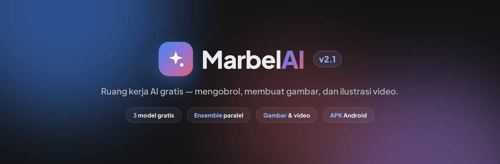
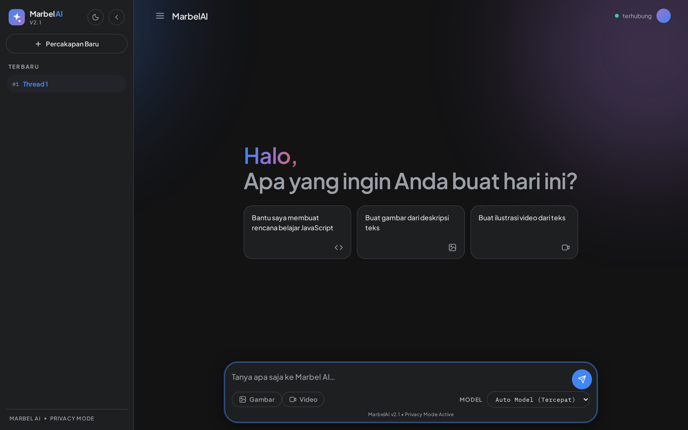
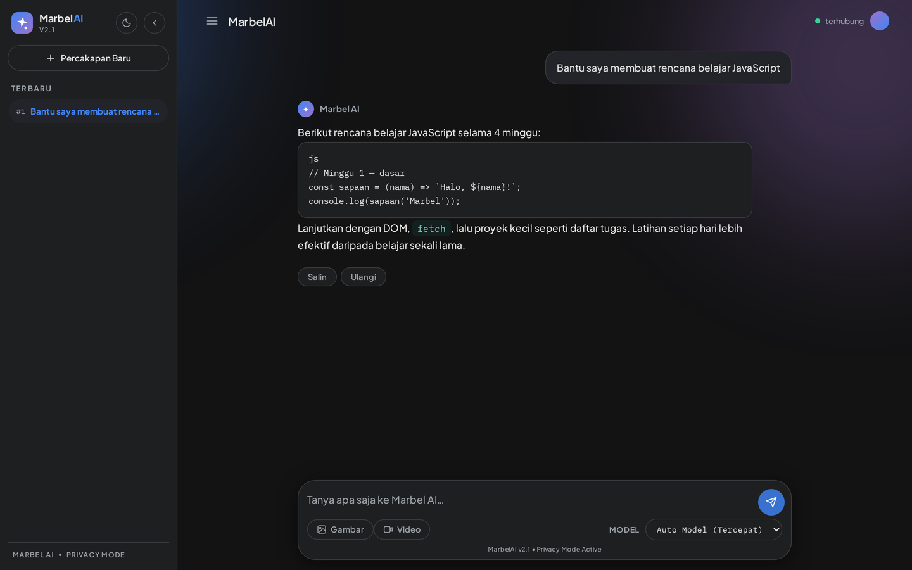
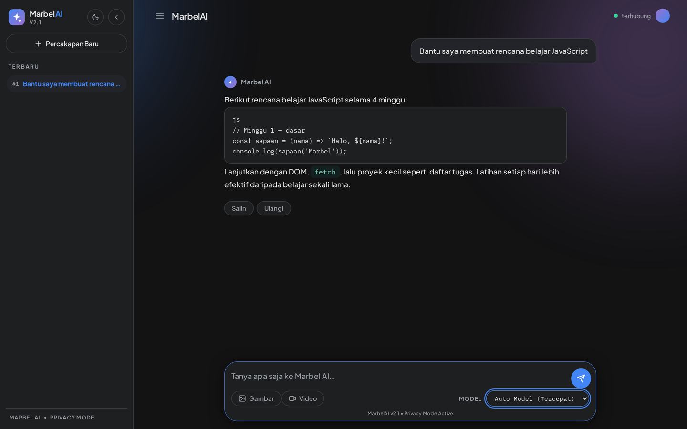
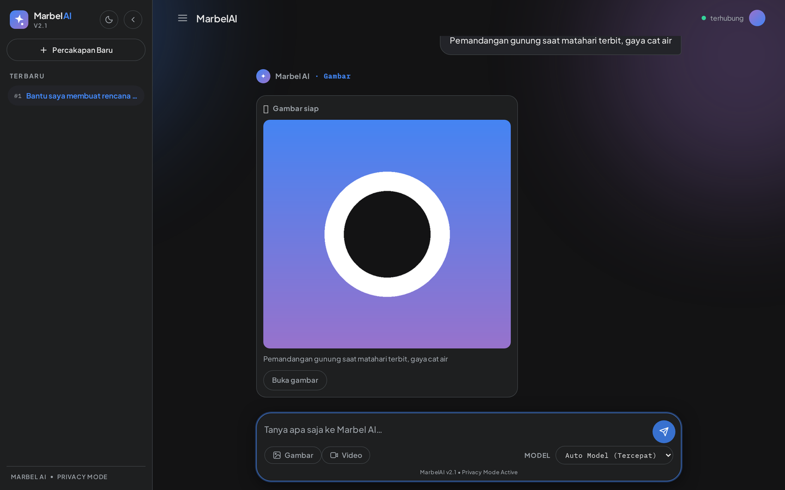
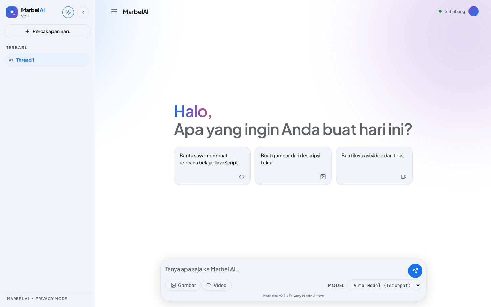
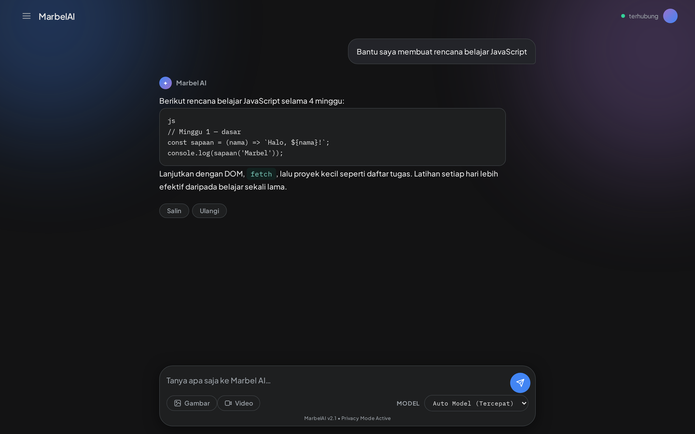
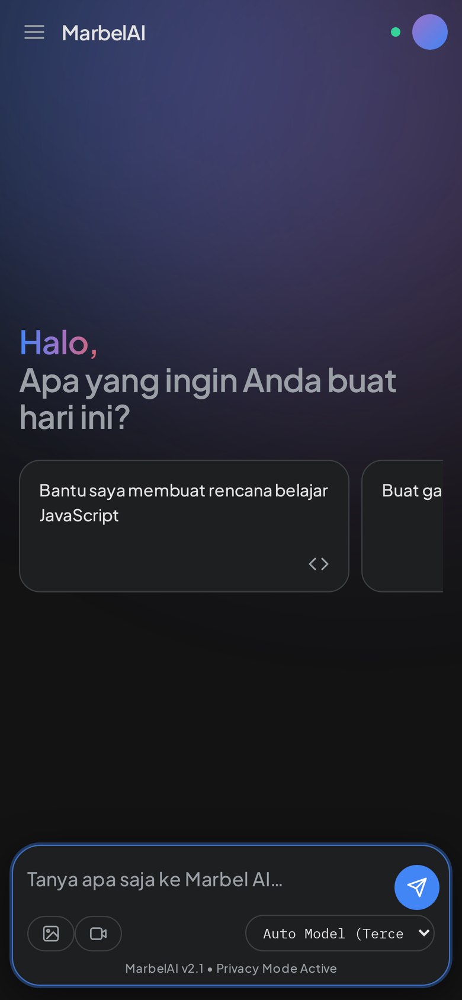
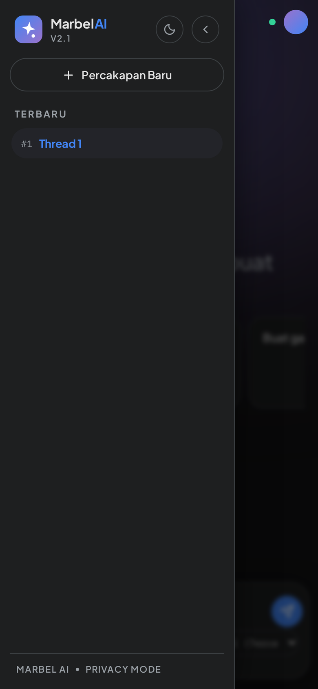

<div align="center">



# Marbel AI v2.1

**Ruang kerja AI gratis — mengobrol, membuat gambar, dan ilustrasi video.**
Tanpa akun, tanpa biaya, tanpa API key.

Satu antarmuka untuk banyak model. Mode **Auto Model** menjalankan semua model
**paralel** lalu memakai jawaban **tercepat yang berhasil**, dengan failover
otomatis antar provider gratis. Tersedia juga sebagai **aplikasi Android (APK)**.

[](https://antono4.github.io/MarbelAIv2.1/)
[](MarbelAI.apk)
[](LICENSE)
[](https://nodejs.org)

</div>

---

## Daftar Isi

- [Apa itu Marbel AI](#apa-itu-marbel-ai)
- [Tangkapan Layar](#tangkapan-layar)
- [Fitur Utama](#fitur-utama)
- [Cara Kerja](#cara-kerja)
- [Mulai Cepat](#mulai-cepat)
- [Model AI Gratis](#model-ai-gratis)
- [Kartu Media (Gambar & Ilustrasi Video)](#kartu-media-gambar--ilustrasi-video)
- [Konfigurasi (Environment Variables)](#konfigurasi-environment-variables)
- [Referensi API](#referensi-api)
- [Docker](#docker)
- [Deployment](#deployment)
- [Aplikasi Android (APK)](#aplikasi-android-apk)
- [Server Lokal & Auto-Restart](#server-lokal--auto-restart)
- [Struktur Proyek](#struktur-proyek)
- [Pemecahan Masalah](#pemecahan-masalah)
- [Lisensi](#lisensi)

---

## Apa itu Marbel AI

Marbel AI adalah aplikasi chat AI ringan yang bisa berjalan **tanpa backend
terpisah**. Semua model yang dipakai adalah model gratis tanpa API key.

| Bagian | Berkas | Peran |
|---|---|---|
| **Frontend** | `index.html`, `app.js`, `styles.css` | Antarmuka chat, mode media, riwayat percakapan, tema |
| **Backend (opsional)** | `server.js` | Server statis + proxy CORS ke provider gratis, dengan failover berurutan |
| **Aplikasi Android** | `android/`, `capacitor.config.json` | Pembungkus WebView (Capacitor) dari UI yang sama |

Ada **dua mode pemanggilan model**, dipilih otomatis berdasarkan tempat halaman
dijalankan:

- **Mode langsung (direct CORS)** — dipakai di **GitHub Pages** dan **aplikasi
  Android**. `app.js` memanggil provider yang mengizinkan CORS langsung dari
  browser. Tidak butuh backend, jadi tetap berjalan 24/7.
- **Mode backend proxy** — dipakai saat halaman disajikan oleh `server.js`
  (Render/Railway/Docker) atau saat memakai `?frontend=URL`. Model dipanggil
  lewat `/api/chat`, dan server melakukan failover antar-upstream.

> **Tanpa biaya & tanpa API key.** Semua model berasal dari daftar
> [no-cost-ai](https://github.com/zebbern/no-cost-ai) dan provider gratis lain.
> Tidak perlu kartu kredit atau akun berbayar.

---

## Tangkapan Layar

**Layar sambutan (mode gelap, default)** — pilih kartu saran, atau aktifkan mode
Gambar/Video.



**Jawaban dengan blok kode + tombol Salin & Ulangi** — setiap jawaban punya aksi
salin dan tulis ulang.



**Pemilih model** — `Auto Model (Tercepat)` untuk ensemble paralel, atau kunci
satu model tertentu.



**Kartu media** — mode Gambar memakai provider gambar gratis dan menampilkan
pratinjau beserta tautan "Buka gambar".



**Mode siang** — tema gelap/terang bisa diganti dari tombol di sidebar.

| Mode gelap (default) | Mode siang |
|:---:|:---:|
|  |  |

**Area chat lebar** — sidebar bisa disembunyikan agar area percakapan lebih luas.



**Tampilan ponsel** — sidebar berubah menjadi *drawer* dengan lapisan *scrim*.

| Layar sambutan | Sidebar terbuka |
|:---:|:---:|
|  |  |

---

## Fitur Utama

- **Ensemble paralel (Auto Model)** — semua model gratis dijalankan sekaligus;
  jawaban lengkap yang **paling cepat berhasil** yang dipakai.
- **Failover berlapis** — mode satu model mencoba model pilihan dulu, lalu
  berpindah berurutan ke model cadangan saat terjadi error 4xx/5xx, rate-limit,
  atau respons kosong.
- **Failover antar-provider** — `server.js` mencoba setiap upstream berurutan;
  `directChat()` melakukan hal yang sama di browser.
- **Pemetaan model per-provider** — model UI (`qwen3.8-27b`, `gpt-oss-20b`,
  `qwen3-8b`) dipetakan ke nama model yang dikenal tiap provider, sehingga
  failover tetap menghasilkan jawaban.
- **Tombol Salin & Ulangi** — salin jawaban, atau minta model menulis ulang
  (jawaban lama dibuang dari konteks agar benar-benar dijawab ulang).
- **Mode Gambar & Ilustrasi Video** — menghasilkan gambar dari teks, lengkap
  dengan status memuat, kotak galat, dan tombol "Coba lagi".
- **Riwayat percakapan** — beberapa *thread* per sesi, bisa dibuka dan
  dilanjutkan; nama thread diambil dari pesan pertama.
- **Tema gelap/terang** — default gelap; pilihan disimpan di `localStorage`.
- **Aplikasi Android** — APK siap instal (`MarbelAI.apk`) yang berjalan mandiri.
- **Header keamanan dasar** — `nosniff`, `X-Frame-Options`, `Referrer-Policy`,
  `Cross-Origin-Opener-Policy`, dan `Permissions-Policy` dipasang di semua
  respons.

---

## Cara Kerja

```
                 ┌──────────────────────────────────────────┐
                 │            Frontend (app.js)             │
                 │   chat · media · thread · tema           │
                 └───────────────┬──────────────────────────┘
                                 │
              ┌──────────────────┴───────────────────┐
              │                                      │
    (GitHub Pages / APK)                     (Render/Railway/Docker
     mode LANGSUNG                            atau ?frontend=URL)
              │                                      │
              ▼                                      ▼
   ┌────────────────────────┐            ┌──────────────────────────┐
   │ DIRECT_UPSTREAMS       │            │ server.js  /api/chat     │
   │ failover berurutan:    │            │ failover berurutan:      │
   │ hermes → qwen →        │            │ UPSTREAM (dipisah koma)  │
   │ pollinations → free.ai │            └────────────┬─────────────┘
   └────────────────────────┘                         │
              │                                       │
              └──────────────► model gratis ◄─────────┘
                     (uncloseai · pollinations · free.ai)
```

**Alur satu pesan:**

1. Pengguna mengetik pesan (atau menekan kartu saran). Jika mode media aktif,
   alurnya berpindah ke [kartu media](#kartu-media-gambar--ilustrasi-video).
2. `chatAnswer()` menyusun urutan model: model pilihan dulu (bila ada), lalu
   sisanya dari `FREE_MODELS`.
3. **Mode Auto** menjalankan semua model paralel (`firstFulfilled`); **mode satu
   model** mencoba berurutan dengan failover.
4. `modelChat()` memilih jalur: langsung (CORS) atau backend proxy.
5. Jawaban dibaca dari `message.content`; bila kosong, dicoba
   `reasoning_content`.
6. Efek mengetik ditampilkan, jawaban disimpan ke riwayat, dan tombol
   Salin/Ulangi diaktifkan.

---

## Mulai Cepat

**Prasyarat:** Node.js **18 atau lebih baru**.

```bash
# 1. Ambil kode
git clone https://github.com/antono4/MarbelAIv2.1.git
cd MarbelAIv2.1

# 2. Jalankan server (static + proxy CORS)
PORT=12000 node server.js

# 3. Buka di browser
#    http://localhost:12000
```

Server menyajikan `index.html`, `app.js`, dan `styles.css` sekaligus menjadi
proxy ke provider gratis di `/api/chat`. Kirim pesan — tidak perlu login atau
API key.

**Memakai backend sendiri dari GitHub Pages:**

```
https://antono4.github.io/MarbelAIv2.1/?frontend=https://backend-anda.example.com
```

---

## Model AI Gratis

Daftar model aktif ada di `FREE_MODELS` (`app.js`) dan `MODELS_LIST` (`server.js`).

| Model | Provider | Keterangan |
|---|---|---|
| `qwen3.8-27b` | uncloseai (hermes/qwen) | Qwen 3.8 27B, gratis tanpa API key, **default** |
| `gpt-oss-20b` | pollinations | GPT-OSS 20B open-weights, tier anonim |
| `qwen3-8b` | Free.ai | Qwen 3 8B, model open-weight gratis |

**Pemetaan model saat failover** — setiap provider mengenal nama model yang
berbeda, jadi model UI dipetakan otomatis:

| Model UI | uncloseai | pollinations | Free.ai |
|---|---|---|---|
| `qwen3.8-27b` | `turboderp/Qwen3.8-27B-exl3` | `openai` | `qwen7b` |
| `gpt-oss-20b` | `turboderp/Qwen3.8-27B-exl3` | `openai` | `qwen7b` |
| `qwen3-8b` | `turboderp/Qwen3.8-27B-exl3` | `openai` | `qwen3-8b` |

> **Catatan uncloseai.** Provider ini memakai vLLM/Qwen yang suka menaruh proses
> berpikir di dalam `content`. Server dan klien mengirim
> `chat_template_kwargs.enable_thinking=false` agar jawaban bersih.
>
> **Catatan provider.** Endpoint gratis mudah kena rate-limit (429) bila banyak
> permintaan datang dari satu IP dalam waktu singkat — terutama dari IP
> datacenter. Failover berurutan di `directChat()` dan `server.js` mengurangi
> hal ini. Nama model upstream sengaja **tidak ditampilkan** di UI.

---

## Kartu Media (Gambar & Ilustrasi Video)

Aktifkan mode lewat tombol **Gambar**/**Video** di composer, atau kartu saran
"Buat gambar/ilustrasi video" di layar sambutan. Prompt yang dikirim menjadi
deskripsi media.

| Mode | Provider | Hasil |
|---|---|---|
| **Gambar** | `https://api.a0.dev/assets/image` | Gambar (WEBP), gratis tanpa API key, CORS aktif |
| **Ilustrasi video** | provider yang sama | Gambar dengan animasi *Ken Burns* (`.media-burns`) |

Kartu media punya tiga status: **memuat**, **siap**, dan **gagal**. Saat gagal,
kotak galat menampilkan tombol **"Coba lagi"** yang memakai **seed baru** —
mengulang URL yang sama hanya akan mengembalikan hasil gagal/cache yang sama.

> **Penting.** Tidak ada provider video gratis yang menyajikan video dari URL
> GET, jadi mode video memakai gambar + animasi, bukan video sungguhan. Sejak
> Sep 2026 `image.pollinations.ai` memblokir tier anonim (402
> `INSUFFICIENT_BALANCE` / 429 `Queue full for IP`) dan `gen.pollinations.ai`
> mewajibkan API key, sehingga endpoint itu tidak lagi dipakai.

---

## Konfigurasi (Environment Variables)

Variabel berikut dibaca `server.js`. Semuanya opsional untuk pemakaian dasar.

| Variabel | Default | Deskripsi |
|---|---|---|
| `PORT` | `12000` | Port HTTP server |
| `UPSTREAM` | `https://hermes.ai.unturf.com,https://qwen.ai.unturf.com,https://text.pollinations.ai,https://api.free.ai` | Daftar upstream OpenAI-compatible, dipisah koma (failover berurutan) |
| `UPSTREAM_PREFIX` | *(kosong)* | Prefix path upstream, bila API berada di sub-path |
| `DEFAULT_MODEL` | `qwen3.8-27b` | Model default bila klien tidak mengirim model |
| `MODELS_LIST` | `qwen3.8-27b,gpt-oss-20b,qwen3-8b` | Daftar model yang dilayani `/api/models` |
| `API_KEY` | *(kosong)* | Opsional, dipakai bila upstream butuh Bearer token |
| `ALLOW_ORIGIN` | `*` | Origin yang diizinkan untuk CORS |
| `USE_SSE` | `1` | `1` = minta streaming, `0` = JSON biasa |
| `FORCE_NO_STREAM` | `1` | `1` = paksa `stream:false` demi keandalan |
| `MODELS_TTL` | `300` | Masa cache daftar model (detik) |
| `DEBUG_LOG` | *(kosong)* | Set `1` untuk mencatat setiap request di konsol |

---

## Referensi API

| Endpoint | Metode | Deskripsi |
|---|---|---|
| `/` | `GET` | UI statis (`index.html`) |
| `/api/models` | `GET` | Daftar model gratis aktif (`MODELS_LIST`), di-cache `MODELS_TTL` detik |
| `/api/chat` | `POST` | Proxy ke upstream OpenAI-compatible dengan failover berurutan |
| `/MarbelAI.apk` | `GET` | Mengunduh APK release (saat disajikan `server.js`) |

**Contoh permintaan chat:**

```bash
curl -X POST http://localhost:12000/api/chat \
  -H "Content-Type: application/json" \
  -d '{
    "model": "qwen3.8-27b",
    "messages": [{ "role": "user", "content": "Halo, siapa kamu?" }]
  }'
```

**Contoh respons `/api/models`:**

```json
{
  "object": "list",
  "data": [
    { "id": "qwen3.8-27b", "object": "model" },
    { "id": "gpt-oss-20b", "object": "model" },
    { "id": "qwen3-8b", "object": "model" }
  ]
}
```

---

## Docker

```bash
docker build -t marbel-ai .

docker run -p 10000:10000 \
  -e PORT=10000 \
  marbel-ai
```

Buka `http://localhost:10000`. Image sudah menyetel `UPSTREAM`, `DEFAULT_MODEL`,
dan `MODELS_LIST` secara default.

---

## Deployment

| Platform | Cara pakai |
|---|---|
| **GitHub Pages** | Frontend statis memanggil provider CORS langsung dari browser — **tanpa backend**, berjalan terus. Lihat [Demo](https://antono4.github.io/MarbelAIv2.1/). Untuk backend sendiri, tambahkan `?frontend=<URL>`. |
| **Render** | Jadikan `render.yaml` sebagai *Blueprint*. |
| **Railway** | Pakai `railway.json`; set `PORT` dan `UPSTREAM` di variabel lingkungan. |
| **Docker** | Lihat bagian [Docker](#docker) di atas. |
| **Android (APK)** | Lihat bagian [Aplikasi Android](#aplikasi-android-apk). |

---

## Aplikasi Android (APK)

APK adalah pembungkus **WebView Capacitor** dari UI yang sama. Aset web
dipaketkan di dalam APK (`webDir: www`), jadi aplikasi berjalan **mandiri** tanpa
backend terpisah.

- **`MarbelAI.apk`** — build **release**, sudah ditandatangani, siap dibagikan.
- **`MarbelAI-debug.apk`** — build debug untuk pengujian (dihasilkan
  `./build-apk.sh`, tidak di-commit).

Instal di perangkat Android (aktifkan "Instal dari sumber tidak dikenal"):

```bash
adb install -r MarbelAI.apk
```

### Membangun sendiri

Prasyarat: **JDK 17+**, **Node.js 18+**, dan **Android SDK** (platform 35 +
build-tools 35).

```bash
export ANDROID_HOME=/path/ke/Android/Sdk

./build-apk.sh            # APK debug
./build-apk.sh release    # APK release
# atau: npm run apk
```

Hasil build ada di `android/app/build/outputs/apk/`. Skrip ini menyalin aset web
ke `www/` dan menghasilkan ikon launcher (`build-icon.py`).

**Detail aplikasi:** `applicationId` `ai.marbel.app`, `minSdk` 23, `targetSdk` 35,
`versionCode` 2, `versionName` 1.1.0, izin `INTERNET`.

> **Keamanan keystore.** Build release ditandatangani memakai
> `android/marbel-release.keystore` melalui `android/keystore.properties`. Kedua
> berkas itu **tidak di-commit** (lihat `.gitignore`). Untuk rilis nyata, buat
> keystore sendiri:
>
> ```bash
> keytool -genkeypair -v -keystore android/marbel-release.keystore \
>   -alias marbel -keyalg RSA -keysize 2048 -validity 10000
> ```

---

## Server Lokal & Auto-Restart

`start-servers.sh` menjalankan dua instance server dengan auto-restart.

```bash
./start-servers.sh           # port 12000 & 12001 + auto-restart (foreground)
./start-servers.sh ensure    # pastikan server hidup; start di background bila belum
./start-servers.sh watchdog  # sekali jalan: pastikan server hidup, lalu keluar
./start-servers.sh status    # cek status
./start-servers.sh stop      # hentikan semua (launcher + server)

./start-servers.sh 7000 8000 # port khusus (override)
```

- Log tiap server: `/tmp/marbel-logs/server-<port>.log`
- Launcher otomatis me-restart server bila proses crash (PID berubah)
- Instance kedua yang melihat launcher hidup akan langsung keluar (tidak
  menimpa pidfile)
- **Autostart**: `~/.marbelai-autostart.sh` (di-wire ke `~/.profile`) memanggil
  `ensure` saat login, dengan auto-detect path proyek (`$MARBEL_PROJECT_DIR` >
  `~/project` > `/workspace/project`)

---

## Struktur Proyek

```
MarbelAIv2.1/
├── index.html               Markup UI
├── app.js                   Frontend: chat, ensemble, media, thread, tema
├── styles.css               Gaya dan tema (gelap/terang)
├── server.js                Server statis + proxy OpenAI-compatible + failover
├── start-servers.sh         Launcher dua server + auto-restart
├── build-apk.sh             Skrip build APK
├── build-icon.py            Generator ikon launcher Android
├── capacitor.config.json    Konfigurasi Capacitor
├── android/                 Proyek Android (Capacitor)
├── MarbelAI.apk             APK release siap instal
├── docs/screenshots/        Gambar untuk README ini
├── Dockerfile               Image Docker
├── render.yaml              Blueprint Render
├── railway.json             Konfigurasi Railway
├── AGENTS.md                Catatan teknis repo untuk kontributor
├── LICENSE                  Lisensi MIT
└── package.json             Metadata + skrip start/apk
```

---

## Pemecahan Masalah

| Gejala | Penyebab umum | Solusi |
|---|---|---|
| Semua model gagal / "Terjadi kesalahan saat menghubungi server" | Provider gratis sedang sibuk (rate-limit 429) | Tunggu sebentar lalu kirim ulang; failover berurutan sudah berjalan |
| Provider menolak dari IP datacenter/lokal | uncloseai mudah kena 429 dari IP non-perangkat | Wajar di lingkungan uji; di perangkat nyata normal |
| Jawaban berisi proses berpikir | Provider tidak menghormati `enable_thinking` | Sudah dikirim otomatis; bila tetap muncul, ganti model |
| Kartu media gagal memuat | Provider gambar sedang sibuk/memblokir tier anonim | Tekan **"Coba lagi"** (memakai seed baru) |
| GitHub Pages tidak menemukan backend | Halaman statis memang mode langsung | Tidak perlu backend; bila ingin backend sendiri pakai `?frontend=URL` |
| APK gagal memanggil model | Provider menolak permintaan dari IP perangkat | Aplikasi otomatis beralih ke proxy cadangan `https://marbel-ai.onrender.com` |
| Build APK gagal | `ANDROID_HOME` belum diset atau SDK kurang | Set `ANDROID_HOME`; pastikan platform 35 + build-tools 35 dan JDK 17+ |

---

## Lisensi

Didistribusikan di bawah [Lisensi MIT](LICENSE). Copyright 2026
[Antono4](https://github.com/antono4).

---

<div align="center">

Dibuat dengan ❤️ — AI gratis untuk semua.

</div>
